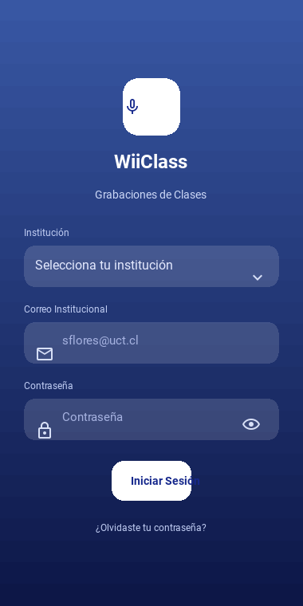
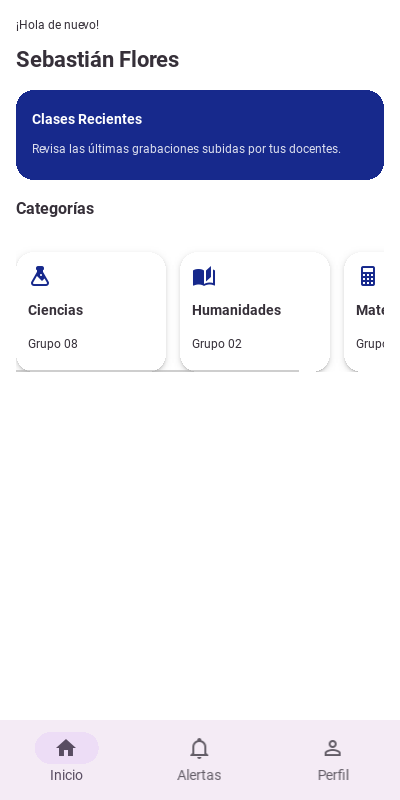
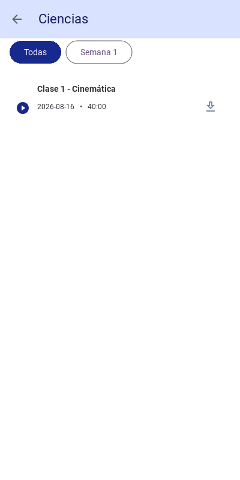
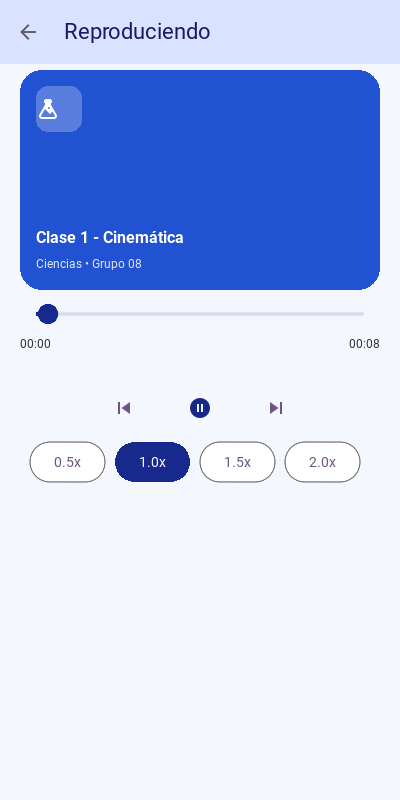
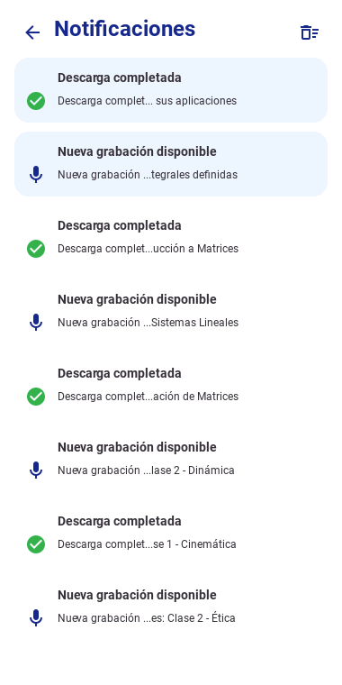

# WiiClass

App móvil (Kivy + KivyMD 2.0 + SQLite) para grabar y descargar clases en
audio, pensada para el WiFi del campus y con modo **sin conexión** para
repasar donde no hay datos móviles.

| Login | Inicio | Categoría | Reproductor | Notificaciones |
|---|---|---|---|---|
|  |  |  |  |  |

## Problema y usuario

Muchos estudiantes no alcanzan a seguir la clase y tomar apuntes a la vez.
WiiClass permite grabarla, organizarla por asignatura/semana y volver a
escucharla (a 0.5x–2x), también offline. El diagnóstico se levantó con
estudiantes de UC Temuco; ver [`docs/ux/`](docs/ux/).

## Ejecutar

```bash
pip install -r requirements.txt
python3 main.py
```

La primera ejecución crea `wiiclass.db` con datos de ejemplo. Usuarios demo
(contraseña `12345678`): `sflores@uct.cl` (Estudiante) y `profesor@uct.cl`
(Profesor). Si `ffpyplayer` no está disponible, la app reproduce igual, sin
cambio de velocidad.

| Rol | Barra inferior |
|---|---|
| Estudiante | Inicio · Descargas (solo **sin** conexión) · Alertas · Perfil |
| Profesor | Inicio · Descargas (solo **con** conexión) · **Grabación** · Alertas · Perfil |

## Estructura

```
main.py                  Entrada (escritorio y Buildozer)
buildozer.spec           Empaquetado Android (iOS comentado)
requirements.txt
wiiclass/
  app.py                 Creación de la app, navegación y sesión
  data/                  db.py (SQLite) · storage.py (JSON)
  services/              analytics · audio_player · downloads_manager · documentos
                         notification_service · recorder · remote_config
  ui/                    theme.py · screens/ (*.py + *.kv, common.kv, widgets.py)
assets/                  audio/ de ejemplo y screenshots/
config/examples/         app_config.json de ejemplo (configuración remota)
docs/                    ux/ · technical/ · project/
scripts/                 ios_habilitar_archivos.py
tools/                   analyze_analytics.py · dev_server/ (serve_config, serve_admin, admin.html)
tests/
```

Dentro de `wiiclass/` los imports son absolutos (`from wiiclass.data import db`).
En ejecución se crean en la raíz `wiiclass.db`, `datos/`, `descargas/` y
`grabaciones/` (ignorados por git).

## Pruebas, herramientas y Android

```bash
python3 -m pytest -q tests                      # no requieren Kivy
python3 tools/dev_server/serve_admin.py         # config remota + panel en :8765/admin.html
python3 tools/analyze_analytics.py              # métricas de datos/analytics.json
buildozer android debug                         # APK en bin/ (Linux/macOS/WSL2)
```

## Documentación

- [`docs/technical/IMPLEMENTACION.md`](docs/technical/IMPLEMENTACION.md): decisiones, bugs y rendimiento (incluye equivalencias con la estructura anterior).
- Temas: [analíticas](docs/technical/ANALITICAS.md) · [configuración remota](docs/technical/CONFIG-REMOTA.md) · [descargas y APK](docs/technical/DESCARGAS-DOCUMENTOS.md) · [notificaciones](docs/technical/NOTIFICACIONES.md) · [persistencia](docs/technical/PERSISTENCIA.md).
- UX/UI: [`docs/ux/`](docs/ux/). Revisiones y [uso de IA](docs/project/USO_IA.md): [`docs/project/`](docs/project/).

## Declaración de uso de IA

Se usó IA (Claude, Anthropic) como asistente de desarrollo y redacción. El
diseño, la arquitectura y la implementación original son del equipo. Detalle
completo en [`docs/project/USO_IA.md`](docs/project/USO_IA.md).
